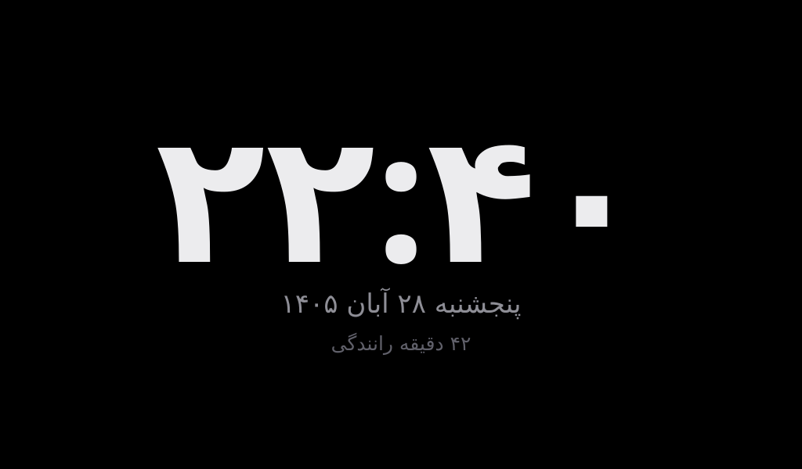

# DriveClock

**A dim clock for Android car head units, instead of turning the screen off.**

[](https://github.com/mani-imani/DriveClock/actions/workflows/build.yml)
[](https://github.com/mani-imani/DriveClock/releases/latest)
[](LICENSE)
[-3DDC84?logo=android&logoColor=white)](#compatibility)

[فارسی](README.md) · Sibling apps: [BlueTune](https://github.com/mani-imani/BlueTune) (Bluetooth music) · [DrivePlay](https://github.com/mani-imani/DrivePlay) (USB / SD player) · [DoorAlert](https://github.com/mani-imani/DoorAlert) (open-door alert)



Many drivers switch the head unit's screen off at night because it's too bright. DriveClock is a simple alternative: the screen never turns off, but it only shows a dim clock on pure black.

## Features

- **Big 24-hour clock** in the middle of the screen, with Persian digits in the Vazirmatn font. Below it: the **Jalali date and weekday**, for example "پنجشنبه ۲۸ آبان ۱۴۰۵".
- **Drive time:** counted from the moment the car is switched on and shown dimly under the date, e.g. "۴۲ دقیقه رانندگی" (42 minutes of driving). If the car is off for under 10 minutes, it counts as the same trip. It counts from ignition, not from movement.
- **Four brightness modes:** normal, low, very low and automatic. Tap the screen for the controls; they leave on their own after a few seconds. Automatic uses *low* during night hours. The default night is 18:00 to 06:00, adjustable with the + and − buttons.
- **Dimming:** the app asks the system for lower screen brightness and also draws a dark overlay. Some head units drive their backlight from the board and ignore the request, but the overlay always works. An LCD never gets as black as a screen that is off.
- **Full-screen:** the head unit's top bar is hidden. Swipe down from the top edge, or tap the top edge, to show it for a few seconds.
- **The screen stays on** while the app is open.
- **After the car is switched off and on,** the clock comes back by itself if it was on screen. If music is playing by then, the music wins and the clock stays out of the way.
- **No internet.** It reads no data from the car and sends no commands to it.

## Compatibility

| | |
|---|---|
| **Car** | JAC S3 |
| **Head unit** | ZQ8003 · board `ZQ_MTK_8007` · MediaTek |
| **Android** | 8.0+ (built for Android 9) |

The clock, the date and the brightness modes work on any Android device. Coming back after the ignition cycle relies on the sleep/wake broadcasts of this family of head units (`android.car.server`). On other units that part is silently skipped.

## Install

1. Download `DriveClock.apk` from the [latest release](https://github.com/mani-imani/DriveClock/releases/latest).
   Direct link: `https://github.com/mani-imani/DriveClock/releases/latest/download/DriveClock.apk`
2. Install it on the head unit. You can open the link in the unit's browser over a phone hotspot, or copy the APK over on a USB stick.
3. Open the app once. No setup is needed.

## Ignition off and on

When the car is switched off, the head unit goes to sleep and force-stops every user-installed app. A force-stopped app doesn't receive regular Android broadcasts. But the vendor system sends its own broadcasts before sleeping and after waking (`android.car.action.ENTER_SLEEP`, `EXIT_SLEEP`, `CAR_BOOT_COMPLETED`), and those also reach stopped apps:

- **Before sleep:** DriveClock notes whether the clock was on screen. If you left the app with the Back button, it won't open itself next time.
- **After wake-up:** DriveClock waits about 10 seconds. If no music is playing, it brings the clock to the screen. If music is playing, the music player (for example DrivePlay) comes first.
- **Trip start:** every time the car is switched on, the drive time starts again from zero.

**It's safe for the car.** These broadcasts are sent by the head unit's own system to every app; DriveClock only listens. It sends no commands to the car and does nothing in the background while the unit sleeps. The app runs a short service for about 10 seconds after the car starts, then stops it.

After installing, the app must be opened at least once so these broadcasts can reach it.

## How it works

- **Jalali date:** produced by a small conversion routine with no external library ([`Jalali.java`](app/src/main/java/ir/maniimani/driveclock/Jalali.java)).
- **Brightness:** a black overlay with variable opacity, plus a `screenBrightness` request for this window only. When the app closes, brightness returns to normal by itself ([`MainActivity.java`](app/src/main/java/ir/maniimani/driveclock/MainActivity.java)).
- **Music first, then the clock:** [`SleepReceiver.java`](app/src/main/java/ir/maniimani/driveclock/SleepReceiver.java) receives the sleep/wake broadcasts, and [`ShowService.java`](app/src/main/java/ir/maniimani/driveclock/ShowService.java) uses `AudioManager.isMusicActive()` to see whether music is playing.

## Building

GitHub Actions builds every push to `main`. When `versionName` changes, the APK is also published to Releases automatically.

```bash
# JDK 17 + Android SDK (compileSdk 34) + Gradle 8.7
gradle assembleRelease
```

To release, bump `versionName` and `versionCode` in `app/build.gradle`, add a `## x.y.z` section to `CHANGELOG.md`, and push.

> The signing key (`app/driveclock.keystore`) is committed on purpose so every build installs over the previous one. This is a sideloaded personal app, and the key is not meant for Google Play.

## Project structure

```
app/src/main/java/ir/maniimani/driveclock/
├── MainActivity.java   Clock screen, brightness levels, controls
├── Jalali.java         Gregorian to Jalali date, Persian names
├── Text.java           Persian digits, time and drive-time text
├── Prefs.java          Settings and shared state
├── Chrome.java         Full-screen mode, top-bar strip
├── SleepReceiver.java  Vendor sleep/wake broadcasts, trip start
└── ShowService.java    Brings the clock back after wake-up (music first)
```

## Other apps for this head unit

- **[BlueTune](https://github.com/mani-imani/BlueTune):** pure-black Bluetooth music
- **[DrivePlay](https://github.com/mani-imani/DrivePlay):** USB / SD card player in the same style
- **[DoorAlert](https://github.com/mani-imani/DoorAlert):** open door / trunk / hood alert

## Built with Claude

Like BlueTune, DrivePlay and DoorAlert, this was built with **[Claude](https://claude.ai)** by Anthropic, on a **Claude Pro** plan. Claude worked through every stage: designing the app, writing the code and setting up CI. The idea, the real-car testing and the design decisions are mine.

## Author

**Mani ImaniSanjar** · [GeekMani](https://t.me/geekmani)
[maniimani.ir](https://maniimani.ir) · [GitHub](https://github.com/mani-imani) · [LinkedIn](https://linkedin.com/in/mani-imani)

## License

Code is released under the [MIT](LICENSE) license. The bundled [Vazirmatn](https://github.com/rastikerdar/vazirmatn) font is under the SIL OFL 1.1. This is an independent project, not affiliated with the head unit manufacturer or JAC Motors. The image is a UI preview.
