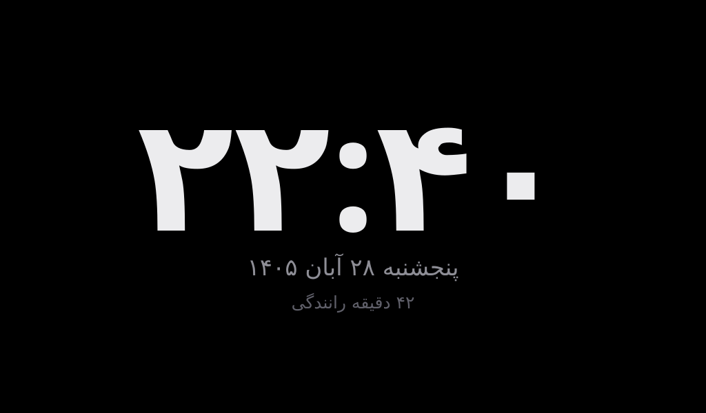

<div dir="rtl">

# DriveClock

**ساعت کم‌نور برای مانیتور اندرویدی ماشین، به‌جای خاموش کردن صفحه**

[](https://github.com/mani-imani/DriveClock/actions/workflows/build.yml)
[](https://github.com/mani-imani/DriveClock/releases/latest)
[](LICENSE)
[-3DDC84?logo=android&logoColor=white)](#سازگاری)

[English README](README.en.md) · اپ‌های هم‌خانواده: [BlueTune](https://github.com/mani-imani/BlueTune) (موزیک بلوتوث) · [DrivePlay](https://github.com/mani-imani/DrivePlay) (پلیر فلش و کارت حافظه) · [DoorAlert](https://github.com/mani-imani/DoorAlert) (هشدار باز موندن در)



خیلی از راننده‌ها شب‌ها مانیتور ماشین رو خاموش می‌کنن، چون نورش اذیت می‌کنه. DriveClock یه جایگزین ساده‌ست: صفحه خاموش نمی‌شه، ولی فقط یه ساعت کم‌نور روی پس‌زمینه‌ی مشکی کامل نشون می‌ده.

## ویژگی‌ها

- **ساعت بزرگ** ۲۴ ساعته وسط صفحه، با اعداد فارسی و فونت وزیرمتن. زیرش **تاریخ شمسی و روز هفته** میاد، مثلاً «پنجشنبه ۲۸ آبان ۱۴۰۵».
- **مدت رانندگی:** از لحظه‌ی روشن شدن ماشین می‌شمره و کم‌نور زیر تاریخ نشون می‌ده، مثلاً «۴۲ دقیقه رانندگی». اگه ماشین کمتر از ۱۰ دقیقه خاموش بشه و دوباره روشن بشه، همون سفر حساب می‌شه. این عدد از روشن شدن ماشین شمرده می‌شه، نه از حرکت کردنش.
- **چهار حالت نور:** عادی، کم، خیلی کم و خودکار. با لمس صفحه نوار کنترل باز می‌شه و چند ثانیه بعد خودش می‌ره. حالت خودکار توی ساعت‌های شب روی «کم» می‌ره. پیش‌فرض شب از ۱۸:۰۰ تا ۰۶:۰۰ هست و با دکمه‌های + و − تغییر می‌کنه.
- **کم کردن نور:** اپ از سیستم می‌خواد نور صفحه رو کم کنه، و علاوه بر اون یه لایه‌ی تیره هم روی صفحه می‌ندازه. بعضی مانیتورها نور صفحه رو با برد خودشون کنترل می‌کنن و درخواست رو نادیده می‌گیرن، ولی لایه‌ی تیره همیشه کار می‌کنه. صفحه‌ی LCD مثل خاموش بودن کاملاً سیاه نمی‌شه.
- **تمام‌صفحه:** نوار بالای مانیتور پنهان می‌شه. با کشیدن یا لمس لبه‌ی بالای صفحه چند ثانیه نمایش داده می‌شه.
- **صفحه خاموش نمی‌شه** تا وقتی اپ بازه.
- **بعد از خاموش و روشن کردن ماشین،** اگه ساعت روی صفحه بوده، خودش دوباره بالا میاد. اگه تا اون موقع موزیک پخش بشه، موزیک اولویت داره و ساعت خودش رو نمیاره.
- **بدون اینترنت.** هیچ داده‌ای از ماشین نمی‌خونه و هیچ دستوری هم به ماشین نمی‌فرسته.

## سازگاری

| | |
|---|---|
| **ماشین** | جک S3 (JAC S3) |
| **مانیتور** | ZQ8003 · برد `ZQ_MTK_8007` · MediaTek |
| **اندروید** | ۸ به بالا، برای اندروید ۹ ساخته شده |

ساعت، تاریخ و حالت‌های نور روی هر دستگاه اندرویدی کار می‌کنن. بالا اومدن بعد از خاموش و روشن شدن ماشین، به پیام‌های خواب و بیدار شدن خود سیستم این خانواده از مانیتورها (`android.car.server`) وابسته‌ست. روی مانیتورهای دیگه این بخش بی‌سروصدا کنار گذاشته می‌شه.

## نصب

1. فایل `DriveClock.apk` رو از [آخرین Release](https://github.com/mani-imani/DriveClock/releases/latest) دانلود کن.
   لینک مستقیم: `https://github.com/mani-imani/DriveClock/releases/latest/download/DriveClock.apk`
2. روی مانیتور نصبش کن. می‌تونی مانیتور رو به هات‌اسپات گوشی وصل کنی و لینک رو توی مرورگرش باز کنی، یا APK رو با فلش منتقل کنی.
3. اپ رو یه بار باز کن. تنظیم خاصی لازم نیست.

## خاموش و روشن کردن ماشین

مانیتور موقع خاموش شدن ماشین می‌ره توی حالت خواب و همه‌ی اپ‌هایی که خودت نصب کردی رو کامل می‌بنده (Force stop). اپ بسته‌شده پیام‌های معمولی اندروید رو دریافت نمی‌کنه. ولی خود سیستم مانیتور قبل از خواب و بعد از بیدار شدن پیام‌هایی می‌فرسته (`android.car.action.ENTER_SLEEP`، `EXIT_SLEEP` و `CAR_BOOT_COMPLETED`) که به اپ‌های بسته‌شده هم می‌رسه:

- **قبل از خواب:** DriveClock یادداشت می‌کنه که ساعت روی صفحه بود یا نه. اگه با دکمه‌ی «برگشت» از اپ بیرون اومده باشی، دفعه‌ی بعد خودش باز نمی‌شه.
- **بعد از بیدار شدن:** DriveClock حدود ۱۰ ثانیه صبر می‌کنه. اگه موزیکی پخش نمی‌شد، ساعت رو میاره روی صفحه. اگه موزیک پخش می‌شد، پلیر موزیک، مثلاً DrivePlay، اولویت داره.
- **شروع سفر:** هر بار که ماشین روشن می‌شه، شمارش مدت رانندگی از صفر شروع می‌شه.

**برای ماشین مشکلی ایجاد نمی‌کنه.** این پیام‌ها رو خود سیستم مانیتور برای همه می‌فرسته و DriveClock فقط گوش می‌ده. هیچ دستوری به ماشین فرستاده نمی‌شه و موقع خواب هم هیچ کاری در پس‌زمینه انجام نمی‌شه. اپ فقط حدود ۱۰ ثانیه بعد از روشن شدن ماشین یه سرویس کوتاه اجرا می‌کنه و بعد خودش رو می‌بنده.

بعد از نصب، اپ باید حداقل یه بار باز بشه تا این پیام‌ها بهش برسه.

## چطور کار می‌کنه

- **تاریخ شمسی:** با یه الگوریتم تبدیل کوچیک ساخته می‌شه، بدون کتابخونه‌ی بیرونی ([`Jalali.java`](app/src/main/java/ir/maniimani/driveclock/Jalali.java)).
- **نور:** یه لایه‌ی مشکی با شفافیت متغیر، به‌علاوه‌ی درخواست `screenBrightness` برای همین پنجره. با بسته شدن اپ، نور خودکار به حالت عادی برمی‌گرده ([`MainActivity.java`](app/src/main/java/ir/maniimani/driveclock/MainActivity.java)).
- **ایستادن موزیک و بالا اومدن:** [`SleepReceiver.java`](app/src/main/java/ir/maniimani/driveclock/SleepReceiver.java) پیام‌های خواب و بیدار شدن رو می‌گیره و [`ShowService.java`](app/src/main/java/ir/maniimani/driveclock/ShowService.java) با `AudioManager.isMusicActive()` چک می‌کنه موزیکی در حال پخش هست یا نه.

## ساخت از سورس

با هر push به `main` بیلد می‌شه. اگه `versionName` بالا بره، Release هم خودکار ساخته می‌شه.

<div dir="ltr">

```bash
# JDK 17 + Android SDK (compileSdk 34) + Gradle 8.7
gradle assembleRelease
```

</div>

برای انتشار یه نسخه‌ی جدید، `versionName` و `versionCode` رو توی `app/build.gradle` بالا ببر، یادداشت‌های نسخه رو با عنوان `## x.y.z` به `CHANGELOG.md` اضافه کن و push کن.

> کلید امضا (`app/driveclock.keystore`) عمداً توی ریپو گذاشته شده تا هر نسخه‌ی جدید روی نسخه‌ی قبلی نصب بشه. این اپ برای نصب دستیه و این کلید برای Google Play در نظر گرفته نشده.

## ساختار پروژه

<div dir="ltr">

```
app/src/main/java/ir/maniimani/driveclock/
├── MainActivity.java   Clock screen, brightness levels, controls
├── Jalali.java         Gregorian to Jalali date, Persian names
├── Text.java           Persian digits, time and drive-time text
├── Prefs.java          Settings and shared state
├── Chrome.java         Full-screen mode, top-bar strip
├── SleepReceiver.java  Vendor sleep/wake broadcasts, trip start
└── ShowService.java    Brings the clock back after wake-up (music first)
```

</div>

## اپ‌های دیگه برای همین مانیتور

- **[BlueTune](https://github.com/mani-imani/BlueTune):** موزیک بلوتوث با تم کاملاً مشکی
- **[DrivePlay](https://github.com/mani-imani/DrivePlay):** پلیر فلش و کارت حافظه با همون طراحی
- **[DoorAlert](https://github.com/mani-imani/DoorAlert):** هشدار باز موندن در، صندوق و کاپوت

## ساخته‌شده با Claude

این پروژه هم مثل BlueTune، DrivePlay و DoorAlert، با کمک **[Claude](https://claude.ai)** ساخته شد، دستیار هوش مصنوعی شرکت Anthropic، روی اشتراک **Claude Pro**. Claude توی همه‌ی مراحل نقش داشت: طراحی اپ، نوشتن کد و راه‌اندازی بیلد خودکار. ایده، تست روی ماشین واقعی و تصمیم‌های طراحی کار خودم بود.

## سازنده

**مانی ایمانی‌سنجر** · [GeekMani](https://t.me/geekmani)
[maniimani.ir](https://maniimani.ir) · [GitHub](https://github.com/mani-imani) · [LinkedIn](https://linkedin.com/in/mani-imani)

## مجوز

کد با مجوز [MIT](LICENSE) منتشر شده. فونت [وزیرمتن](https://github.com/rastikerdar/vazirmatn) با مجوز SIL OFL 1.1 همراه اپ قرار گرفته. این پروژه مستقله و هیچ ارتباطی با سازنده‌ی مانیتور یا خودروسازی جک نداره. عکس این صفحه پیش‌نمایش رابط کاربریه.

</div>
